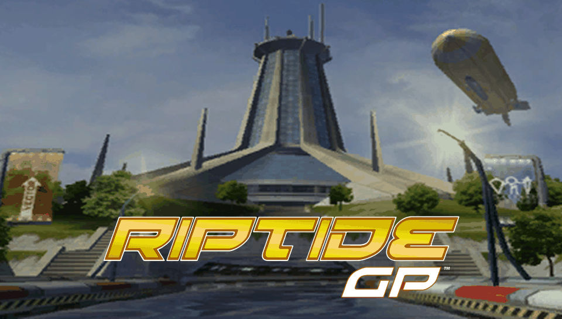

<h1 align="center">
  <br>
  Riptide GP · PS Vita Port
</h1>

<p align="center">
  <b>Native port of Riptide GP (Vector Unit) for PlayStation Vita and PlayStation TV.</b>
</p>

<p align="center">
  
  
  
  
  
  
</p>

<p align="center">
  <a href="#-description">Description</a> •
  <a href="#-features">Features</a> •
  <a href="#-controls">Controls</a> •
  <a href="#-installation">Installation</a> •
  <a href="#-known-issues">Known Issues</a> •
  <a href="#-building-from-source">Build</a> •
  <a href="#-credits">Credits</a>
</p>

---

## 📖 Description

**Riptide GP** is the Vector Unit hovercraft racing game, originally released for Android as
`Riptide-GP-v1-6-3.apk` (Android version 1.6.3, `armeabi-v7a`).

This is a so-loader port. It runs the original `libBlue.so`, `libfmodex.so` and `libfmodevent.so` with an
emulated Java layer (FalsoJNI). The game's own assets are read in place from `assets/Base.apf`, and the
OpenGL ES 2.0 calls are served by [vitaGL](https://github.com/Rinnegatamante/vitaGL). Nothing from the game is
distributed here; you need your own copy of the APK.

---

## 🎮 Status & Playability

**Status: Playable (v1.0.3)** — the main menu and racing were confirmed playable on real hardware. All 57 shader
programs compile and link on the console, with zero link failures and zero crashes in the logged run.

- [x] **Loader**: boots through the NativeActivity lifecycle (`OnInitApp` / `OnInitWindow`), loads all assets from `Base.apf`. *Verified on console.*
- [x] **Graphics**: 57 shader programs compile and link; locked 60 FPS in races (as reported in `RELEASE.md`). *Verified on console.*
- [x] **Audio**: FMOD music and sound effects through AudioTrack output. *Verified on console.*
- [x] **Saves**: progress is written to `ux0:data/riptidegp/files/profile` and restored across launches. *Verified on console.*
- [x] **Trophies**: native PS Vita trophies (29 + Platinum) with NoTrpDrm. *Verified on console (per `RELEASE.md`).*
- [x] **Offline Google Play replacement**: Sign In button hidden, achievements screen and personal-records leaderboard work.
- [x] **Tilt steering**: Vita accelerometer drives the game's tilt control.
- [ ] **Physical buttons / sticks in tilt mode**: they only work with the game's *Simple* control method (see Known Issues).

### ✨ What works

- Boot through the NativeActivity lifecycle (`OnInitApp` / `OnInitWindow`) with full asset loading from
  `assets/Base.apf` (textures, shaders, sounds).
- Main menu and racing, confirmed playable on real hardware.
- FMOD music and sound effects (AudioTrack output).
- Progress saved and restored across launches: continue championships, keep unlocked boats and upgrades.
- Locked 60 FPS in races.
- Tilt steering with the Vita's accelerometer.
- Native PS Vita trophies (29 + Platinum).
- Offline achievements screen and personal-records leaderboard (no Google Play).
- Logs per run in `ux0:data/riptidegp/logs/`.

### 🔧 Port fixes

Three bugs stood between the APK and a fully playable game, each found on real hardware:

- **Crash in `glBindAttribLocation` on the first shader.** The engine binds its ~10 attribute locations right
  after `glCreateProgram()`, before attaching any shader. That is legal GLES2, but vitaGL dereferences the
  program's vertex shader without a `NULL` check (upstream has the same bug). The loader now queues those bindings
  and replays them inside `glLinkProgram`, where the shaders are already attached; a link failure is reported with
  the program info log.
- **Permanent black screen with music playing.** The prebuilt `libvitaGL.a` in VitaSDK is not built with
  `SOFTFP_ABI=1`, but the loader is softfp (the Android `.so` requires it), so floats crossing loader↔vitaGL
  arrived garbled. vitaGL is now vendored (`vendor/vitaGL`, same tree as the Carnivores Vita ports) and built with
  the softfp ABI. Same root cause as Carnivores logs 004–007.
- **Progress reset on every launch (fixed in 1.0.1).** `VuGenericFile::size()` inlines `fileno()` as a read of
  bionic's `FILE::_file` (offset `0x0E`) and passes it to `fstat()`. The loader's `FILE*` comes from SceLibc with a
  different layout, so it always got fd 0, `fstat` failed and the profile looked empty. `source/patch.c` hooks the
  function and computes the size with `ftell`/`fseek`.

### 📜 Changelog

**v1.0.3**
- **Google Sign In button removed** from the bottom-left of the main menu. The game now signs in "offline" with
  your PS Vita username.
- **Achievements screen opens** from the menu (the game's own list, with your progress).
- **Leaderboard shows your personal records.** Without online servers, the table lists your best time on every
  event you have completed (Race = total time, Hot Lap = best lap).
- Trophies from 1.0.2 keep working as before.
- **Updating from 1.0.2:** install the new `riptidegp.vpk` over the old one. Data files and your save stay as they are.

**v1.0.1**
- Fixed the save-progress reset (`VuGenericFile::size` hook, see *Port fixes* above). v1.0.0 wrote the profile but
  could not read it back, so progress reset on every launch.

**v1.0.0 "First Ride"**
- First playable release: menus and racing confirmed on real hardware, all 57 shader programs linking.

---

## ✨ Features

| Feature | Status | Notes |
| :--- | :---: | :--- |
| Boots to gameplay | ✅ | Boot through NativeActivity, assets loaded from `Base.apf` |
| Graphics / renderer | ✅ | vitaGL (softfp, vendored); 57 shader programs link on console |
| Audio & music | ✅ | FMOD music and SFX via AudioTrack output |
| Video / cutscenes | 🧪 | Not tested yet |
| Physical buttons | 🟡 | Only with the game's *Simple* control method; tilt steering disables them |
| Analog sticks / camera | 🟡 | Forwarded as MOGA axes; same *Simple* method limitation |
| Touch screen | ✅ | Menus are used with the touch screen |
| Button remapping / port menu | ➖ | No port menu; the game's own control options apply |
| Save data | ✅ | `ux0:data/riptidegp/files/profile`, restored across launches |
| Native trophies | ✅ | 29 + Platinum via NoTrpDrm (optional) |
| Languages | 🧪 | ❔ <!-- TODO: not documented in the repo --> |
| Performance | ✅ | Locked 60 FPS in races (as reported in `RELEASE.md`) |
| Online / IAP / ads | ➖ | Google Play replaced offline; no online scores |
| PS TV | 🧪 | Listed as supported in `RELEASE.md`; not separately confirmed |

Legend: `✅ Working (verified on console) · 🧪 Implemented, not yet verified on console · 🟡 Partial · ❌ Not working · ➖ Not applicable · ❔ Not documented yet`

---

## 🎯 Controls

| Vita | Action |
| :--- | :--- |
| Touch screen | Original touch controls (menus) |
| Tilt the console | Accelerometer (tilt steering) |
| Left stick | Left analog axis (MOGA X/Y) |
| Right stick | Right analog axis (MOGA Z/RZ) |
| Cross / Circle / Square / Triangle | MOGA A / B / X / Y |
| L / L2 (PSTV/DS4) | MOGA L1 / L2 (left trigger axis mirrors them) |
| R / R2 | MOGA R1 / R2 (right trigger axis mirrors them) |
| L3 / R3 | MOGA thumb buttons |
| D-pad | MOGA D-pad |
| Select / Start | MOGA Select / Start |

Buttons and sticks are forwarded as MOGA gamepad events (`VuGamePadHelper`), the same interface the Android
version uses for external gamepads, so in-game meaning follows the game's own gamepad mapping. In menus, use the
touch screen.

> **Physical controls vs. tilt:** the buttons and sticks only work with the game's **Simple** control method. If
> you switch to tilt steering in the game's options, the console's tilt steers the boat and the physical
> buttons/sticks stop responding; switch back to Simple to use them again.

---

## 🏆 Trophies

The game's 29 offline achievements unlock native PS Vita trophies (plus a Platinum). This needs the NoTrpDrm plugin
under `*main` in `ur0:tai/config.txt`. Achievements already earned in an existing save are granted the next time any
achievement progresses. "Throw Down" (beat a friend's challenge) needs Google Play and has no trophy. The trophy pack
is generated with `extras/scripts/generate_trophies.py`.

## 📋 Prerequisites

1. PS Vita / PS TV on **HENkaku / Enso** (3.60–3.74 with a kernel plugin loader).
2. [**kubridge**](https://github.com/TheOfficialFloW/kubridge/releases) (`kubridge.skprx`) in `*KERNEL` of your taiHEN config (`ur0:tai/config.txt`).
3. [**libshacccg.suprx**](https://github.com/Rinnegatamante/ShaRKBR33D/releases/latest) in `ur0:data/` (use ShaRKBR33D). The loader aborts with a dialog if it is missing.
4. A legally obtained copy of **Riptide GP 1.6.3** for Android (`armeabi-v7a`).
5. *(Optional, for trophies)* [**NoTrpDrm**](https://github.com/Rinnegatamante/NoTrpDrm) (`NoTrpDrm.suprx`) under `*main` in `ur0:tai/config.txt`.

## 📦 Installation


1. Install `riptidegp.vpk` with **VitaShell**.
2. Create `ux0:data/riptidegp/` and copy into it:
   - `libBlue.so`, `libfmodex.so` and `libfmodevent.so` from the APK's `lib/armeabi-v7a/` folder
   - `assets/Base.apf` from the APK's `assets/` folder (37 MB)
3. Launch the game. Logs go to `ux0:data/riptidegp/logs/`.

Alternative: stage the same layout under `ux0_data/riptidegp/` and run
`extras/scripts/upload_data.sh <vita-ip>` (add `--no-assets` to skip re-uploading `Base.apf`).

### Final File Structure in `ux0:data/riptidegp/`

```text
ux0:data/riptidegp/
├── libBlue.so           <- lib/armeabi-v7a/ in the APK
├── libfmodex.so         <- lib/armeabi-v7a/ in the APK
├── libfmodevent.so      <- lib/armeabi-v7a/ in the APK
├── assets/
│   └── Base.apf         <- assets/ in the APK (37 MB)
├── files/
│   └── profile          <- save data (created by the game)
├── config.txt           <- optional settings (one key value per line)
└── logs/                <- per-run logs (riptidegp_NNN.log)
```

### Save data

Progress is stored in a single file:

```
ux0:data/riptidegp/files/profile
```

The game creates it on first launch and rewrites it every time it saves; you don't need to create any folder for
it. A `ux0:data/riptidegp/saves/` folder is **not** required — the game never reads or writes it. You can use it
(or any other folder) to keep a manual backup of `profile`: to restore, copy it back to `ux0:data/riptidegp/files/`
with VitaShell while the game is closed.

> v1.0.0 wrote the profile but could not read it back (the engine read the file size through a bionic-only `FILE`
> field), so progress reset on every launch. Fixed in v1.0.1 by hooking `VuGenericFile::size` in `source/patch.c`.

### ⚙️ Options

Edit `ux0:data/riptidegp/config.txt` (one `key value` per line; create it if missing):

| Key | Default | Meaning |
| :--- | :---: | :--- |
| `accelerometer` | `1` | `1` = the Vita's motion sensor drives the game's tilt steering; `0` = report the console lying flat (no tilt) |
| `invert_tilt` | `0` | `1` = swap left/right tilt |

Pick the tilt control method in the game's own options to steer by tilting the console (this disables the physical
buttons/sticks; see Controls).

### Google Play (offline)

Google Play Games is replaced offline: the Sign In button is hidden, the menu's achievements screen shows the game's
own list, and the leaderboard lists your personal best on each event (no online scores).

---

## 🐛 Known Issues

- **Physical buttons and sticks only work with the *Simple* control method.** With tilt steering selected in the
  game's options, tilting steers the boat but the buttons/sticks stop responding. Switch back to *Simple* to use them.
- Report anything else with the newest log from `ux0:data/riptidegp/logs/` (and the `.psp2dmp` from `ux0:data/` for a crash).

---

## 🔨 Building from Source

Requires VitaSDK. vitaGL is vendored in `vendor/vitaGL` (same tree as the Carnivores Vita ports) and built
automatically with `SOFTFP_ABI=1 NO_SPLASHSCREEN=1 NO_DEBUG=1 HAVE_SHADER_CACHE=1`. Build and deploy with
psvita-port-toolkit (`psvita-toolkit build`, `psvita-toolkit deploy --vpk`), or plain CMake:

```sh
mkdir -p build && cd build && cmake .. -DCMAKE_POLICY_VERSION_MINIMUM=3.5 && make
```

The `lib/falso_jni` directory is a git submodule (`v-atamanenko/FalsoJNI`); clone with submodules or run
`git submodule update --init`.

Two gotchas this port depends on:

- The prebuilt `libvitaGL.a` from VitaSDK is not built with `SOFTFP_ABI=1`, and this loader is softfp (the Android
  `.so` requires it): with it the game runs with music on a permanently black screen. Hence the vendored vitaGL.
- The engine binds attribute locations right after `glCreateProgram()`, before any `glAttachShader()` (legal GLES2,
  bindings latch at link). vitaGL dereferences the program's vertex shader unconditionally and crashes on the
  `NULL`. `source/utils/glutil.c` queues those bindings and replays them inside `glLinkProgram`.

## 📁 Project Structure

- `source/`: loader core (`main.c`, `patch.c`, `controls.c`, `dynlib.c`), `source/reimpl/` (Android/bionic reimplementations: native activity, looper, sensors, audio), `source/utils/` (GL utilities such as `glutil.c`).
- `lib/falso_jni/`: FalsoJNI (git submodule).
- `vendor/vitaGL/`: vitaGL built from source (softfp ABI).
- `extras/`: LiveArea assets, `scripts/` (`upload_data.sh`, `generate_trophies.py`).
- `ux0_data/riptidegp/`: staging tree for the game data (gitignored).
- `PORTING_PLAN.md` / `port_progress.md`: porting notes and bug-by-bug progress log.
- `RELEASE.md`: release checklist and release text.

---

## 📜 Disclaimer

**Riptide GP** is a trademark of **Vector Unit**. The work presented in this repository is unofficial and is not
produced, endorsed, or sanctioned by Vector Unit or any affiliated entities.

This software does not contain the original game code, binaries, or assets. The authors do not promote or condone
piracy in any way. To play, you must provide your own legally obtained copy of the game (`.apk`).

---

## ☕ Support My Work

This project is **free** and will stay free. If you enjoy it, a tip from **$1** helps me keep porting games to the PS Vita:

<p align="center">
  <a href="https://ko-fi.com/metalsyntax"></a>
</p>

- **Ko-fi:** [ko-fi.com/metalsyntax](https://ko-fi.com/metalsyntax)
- **PayPal:** [paypal.me/MetalSyntax](https://paypal.me/MetalSyntax)
- **Bitcoin (BTC):** `133HdCsaWxdjTfmwpgGVykByhNBV338uRc`

**Ko-fi supporters get:**
- **Early access** to new ports before their public release (test builds of upcoming projects).
- **Data preparation scripts and step-by-step guides** to set up your own game files for each new port.
- A say in which games I port next.

> Game files are never distributed. You always need your own legally obtained copy of the game.

---

## 👥 Credits

- **Vector Unit**: original developer of Riptide GP.
- **MetalSyntax**: this port.
- Based on [soloader-boilerplate](https://github.com/v-atamanenko/soloader-boilerplate) (TheFloW, Rinnegatamante, Volodymyr Atamanenko) and FalsoJNI.
- **Rinnegatamante**: [vitaGL](https://github.com/Rinnegatamante/vitaGL) and [NoTrpDrm](https://github.com/Rinnegatamante/NoTrpDrm).
- **bythos**: kubridge.
- Special thanks to the PS Vita homebrew and porting community.

---

## 📄 License

The loader is MIT-licensed — see the [LICENSE](LICENSE) file. The game, its assets and its `.so` files remain the
property of Vector Unit.
