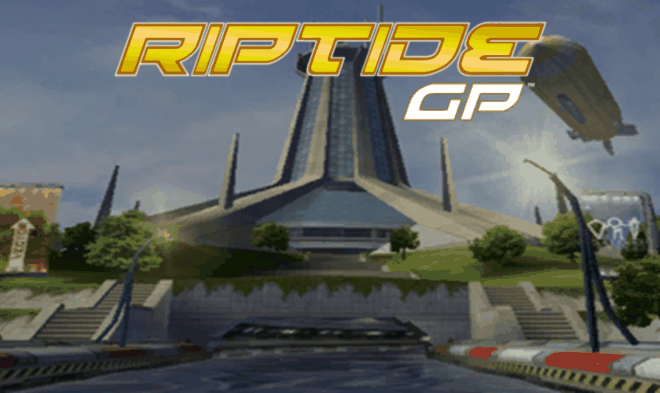

# Riptide GP — PS Vita port

<p align="center">
  
</p>

so-loader port of the Android version (1.6.3) of *Riptide GP* (Vector Unit).
It runs the original `libBlue.so` + `libfmodex.so` + `libfmodevent.so` with an emulated Java layer (FalsoJNI).
You need your own copy of the game APK; nothing from the game is distributed here.

> Status: menus and racing run on real hardware. See [`RELEASE.md`](RELEASE.md) and
> `port_progress.md`.

## Install

1. Install `kubridge.skprx` and `libshacccg.suprx` (ShaRKBR33D).
2. Install `riptidegp.vpk`.
3. Create `ux0:data/riptidegp/` and copy into it:
   - `libBlue.so`, `libfmodex.so` and `libfmodevent.so` from the APK's `lib/armeabi-v7a/` folder
   - `assets/Base.apf` from the APK's `assets/` folder (37 MB)
4. Launch. Logs go to `ux0:data/riptidegp/logs/`.

Alternative: stage the same layout under `ux0_data/riptidegp/` and run
`extras/scripts/upload_data.sh <vita-ip>` (add `--no-assets` to skip re-uploading `Base.apf`).

### Trophies (optional)

The game's 29 offline achievements unlock native PS Vita trophies (plus a Platinum).
This needs the [NoTrpDrm](https://github.com/Rinnegatamante/NoTrpDrm) plugin under
`*main` in `ur0:tai/config.txt`. Achievements already earned in an existing save are
granted the next time any achievement progresses. "Throw Down" (beat a friend's
challenge) needs Google Play and has no trophy. The trophy pack is generated with
`extras/scripts/generate_trophies.py`.

### Google Play (offline)

Google Play Games is replaced offline: the Sign In button is hidden, the menu's
achievements screen shows the game's own list, and the leaderboard lists your personal
best on each event (no online scores).

## Save data

Progress is stored in a single file:

```
ux0:data/riptidegp/files/profile
```

The game creates it on first launch and rewrites it every time it saves; you don't need to create
any folder for it. A `ux0:data/riptidegp/saves/` folder is **not** required — the game never reads
or writes it. You can use it (or any other folder) to keep a manual backup of `profile`: to restore,
copy it back to `ux0:data/riptidegp/files/` with VitaShell while the game is closed.

> v1.0.0 wrote the profile but could not read it back (the engine read the file size
> through a bionic-only `FILE` field), so progress reset on every launch. Fixed in v1.0.1 by hooking
> `VuGenericFile::size` in `source/patch.c`.

## Controls

| Vita | Action |
|---|---|
| Touch screen | Original touch controls |
| Tilt the console | Accelerometer (tilt steering) |
| Left stick | Left analog axis (MOGA X/Y) |
| Right stick | Right analog axis (MOGA Z/RZ) |
| Cross / Circle / Square / Triangle | MOGA A / B / X / Y |
| L / L2 (PSTV/DS4) | MOGA L1 / L2 (left trigger axis mirrors them) |
| R / R2 | MOGA R1 / R2 (right trigger axis mirrors them) |
| L3 / R3 | MOGA thumb buttons |
| D-pad | MOGA D-pad |
| Select / Start | MOGA Select / Start |

Buttons and sticks are forwarded as MOGA gamepad events (`VuGamePadHelper`), the same
interface the Android version uses for external gamepads, so in-game meaning follows the
game's own gamepad mapping. In menus, use the touch screen.

> **Physical controls vs. tilt:** the buttons and sticks only work with the game's **Simple**
> control method. If you switch to tilt steering in the game's options, the console's tilt
> steers the boat and the physical buttons/sticks stop responding; switch back to Simple to use
> them again.

## Options

Edit `ux0:data/riptidegp/config.txt` (one `key value` per line; create it if missing):

| Key | Default | Meaning |
|---|---|---|
| `accelerometer` | `1` | `1` = the Vita's motion sensor drives the game's tilt steering; `0` = report the console lying flat (no tilt) |
| `invert_tilt` | `0` | `1` = swap left/right tilt |

Pick the tilt control method in the game's own options to steer by tilting the console (this
disables the physical buttons/sticks; see Controls).

## Building

Requires VitaSDK. vitaGL is vendored in `vendor/vitaGL` (same tree as the Carnivores Vita
ports) and built automatically with `SOFTFP_ABI=1 NO_SPLASHSCREEN=1 NO_DEBUG=1 HAVE_SHADER_CACHE=1`.
Build and deploy with psvita-port-toolkit (`psvita-toolkit build`, `psvita-toolkit deploy --vpk`),
or plain CMake:

```sh
mkdir -p build && cd build && cmake .. -DCMAKE_POLICY_VERSION_MINIMUM=3.5 && make
```

Two gotchas this port depends on:

- The prebuilt `libvitaGL.a` from VitaSDK is not built with `SOFTFP_ABI=1`, and this loader is
  softfp (the Android `.so` requires it): with it the game runs with music on a permanently
  black screen. Hence the vendored vitaGL.
- The engine binds attribute locations right after `glCreateProgram()`, before any
  `glAttachShader()` (legal GLES2, bindings latch at link). vitaGL dereferences the program's
  vertex shader unconditionally and crashes on the `NULL`. `source/utils/glutil.c` queues those
  bindings and replays them inside `glLinkProgram`, where the shaders are already attached.

## ☕ Support My Work

This project is **free** and will stay free. If you enjoy it, a tip from **$1** helps me keep porting games to the PS Vita:

<p align="center">
  <a href="https://ko-fi.com/metalsyntax"></a>
</p>

- **Ko-fi:** [ko-fi.com/metalsyntax](https://ko-fi.com/metalsyntax)
- **PayPal:** [paypal.me/MetalSyntax](https://paypal.me/MetalSyntax)
- **Bitcoin (BTC):** `133HdCsaWxdjTfmwpgGVykByhNBV338uRc`

**Ko-fi supporters get:**
- **Early access** to new ports before their public release (test builds of upcoming projects).
- **Data preparation scripts and step-by-step guides** to set up your own game files for each new port.
- A say in which games I port next.

> Game files are never distributed. You always need your own legally obtained copy of the game.

---

## Credits

Based on [soloader-boilerplate](https://github.com/v-atamanenko/soloader-boilerplate) (TheFloW, Rinnegatamante,
Volodymyr Atamanenko) and FalsoJNI. vitaGL by Rinnegatamante, kubridge by bythos.

## License

The loader is MIT-licensed (see [LICENSE](LICENSE)). The game, its assets and its `.so` files remain
the property of Vector Unit.
